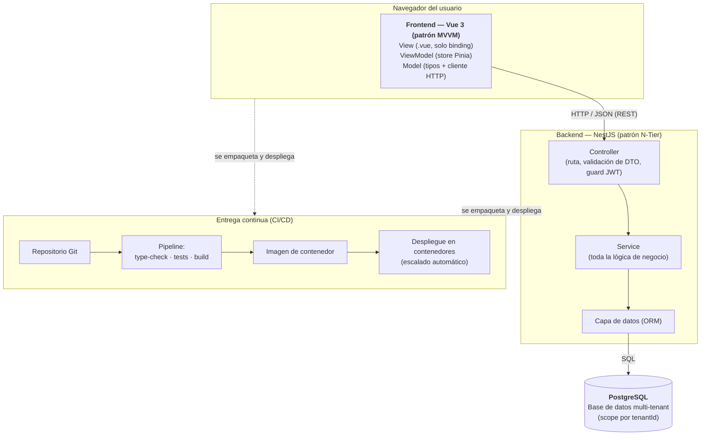

# Arquitectura — Módulo Kuentas

Kuentas es una aplicación SaaS de contabilidad tributaria (dominio chileno: SII,
plan de cuentas, Renta Líquida, Declaraciones Juradas). Está construida como un
**monolito modular multi-tenant**: una sola aplicación backend y una sola base de
datos, donde cada consultora contable opera como un *tenant* con sus datos
completamente aislados del resto.

La arquitectura separa responsabilidades en tres capas, cada una con un patrón
definido, y se despliega sobre contenedores con integración y despliegue continuos.

## Diagrama

## Explicación de cada capa

### 1. Frontend — Vue 3 (MVVM)
Aplicación de página única desarrollada en **Vue 3** con TypeScript, Vite como
empaquetador, **Pinia** para el estado y Vue Router para la navegación. Sigue el
patrón **MVVM**:

- **View**: componentes `.vue` que solo enlazan datos y eventos; no contienen
  lógica de negocio.
- **ViewModel**: *stores* de Pinia que exponen el estado y las acciones a la vista.
- **Model**: los tipos de datos y un cliente HTTP central que es el único punto de
  comunicación con el backend.

El frontend **nunca accede directamente a la base de datos**: toda la información
viaja por HTTP/JSON hacia la API.

### 2. Backend — NestJS (N-Tier)
API REST construida en **NestJS** sobre TypeScript, con un ORM para el acceso a
datos y autenticación mediante **JWT**. Sigue una arquitectura **N-Tier** en la que
cada petición atraviesa capas con una única responsabilidad:

- **Controller**: define la ruta, valida el *payload* de entrada (DTO) y aplica los
  *guards* de autenticación/autorización.
- **Service**: concentra **toda la lógica de negocio** (validaciones contables,
  cuadratura de partida doble, resolución de catálogos, etc.).
- **Capa de datos (ORM)**: es el único componente que conversa con PostgreSQL.

Cada funcionalidad nueva se implementa como un **módulo** independiente
(`módulo + controller + service + DTOs`), lo que mantiene el código organizado y
testeable. Todas las consultas se ejecutan siempre acotadas al `tenantId`, lo que
garantiza el aislamiento entre consultoras.

### 3. Base de datos — PostgreSQL
Base de datos relacional **PostgreSQL** gestionada mediante migraciones versionadas.
El modelo es **multi-tenant**: las entidades cuelgan de un `Tenant` (la consultora) o
de una `Company` (la empresa contabilizada) y nunca son visibles ni modificables
entre tenants distintos. El detalle del modelo de datos se documenta en
[ModeloDatos.md](../../Evidencias%20de%20sistema/Base%20de%20datos/Kuentas/ModeloDatos.md).

### 4. Despliegue en contenedores con CI/CD
Tanto el frontend como el backend se empaquetan como **imágenes de contenedor** y se
ejecutan en una plataforma de contenedores con **escalado automático**. La entrega es
continua:

- En cada *pull request* el pipeline ejecuta **type-check + pruebas automatizadas +
  build** de cada aplicación; si algo falla, el cambio no se integra.
- Al integrar a la rama principal, el mismo conjunto de verificaciones actúa como
  *gate*: solo se construye y despliega la imagen si las pruebas pasan.

Esto asegura que ninguna versión llegue al entorno desplegado sin haber superado la
verificación de tipos y la batería de pruebas.
