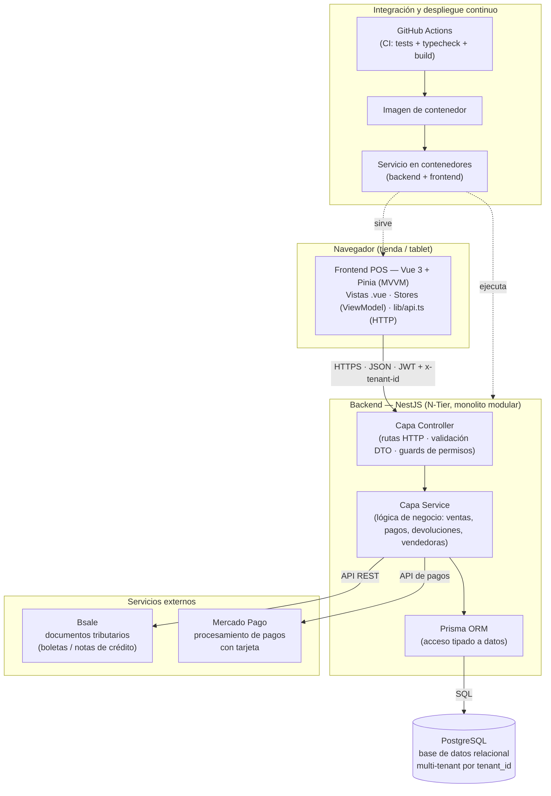

# Arquitectura del módulo POS — PittySoft

> **Evidencia académica — Proyecto CAPSTONE, Ingeniería en Informática (Duoc UC).**
> Este documento es un resumen técnico del módulo Punto de Venta (POS) de PittySoft,
> elaborado a partir del código real del proyecto. No contiene credenciales, dominios
> privados, direcciones IP ni identificadores de infraestructura.

## 1. Visión general

PittySoft es un **ERP + Punto de Venta (POS) para ópticas**. El módulo POS cubre el flujo
comercial de la tienda: ventas, carrito, cobro, emisión de documentos tributarios,
devoluciones, clientes, citas y órdenes de trabajo.

La solución sigue una arquitectura de **monolito modular multi-frontend**:

- **Frontend (POS):** aplicación web desarrollada en **Vue 3** (Composition API + TypeScript),
  construida con **Vite** y con estado gestionado mediante **Pinia** (patrón **MVVM**).
- **Backend (único y compartido):** API **NestJS** sobre Node.js, organizada en **N-Tier**
  (Controller → Service → ORM), con **Prisma** como ORM y **PostgreSQL** como base de datos.
- **Integraciones externas:** **Bsale** para documentos tributarios electrónicos (boletas y
  notas de crédito) y **Mercado Pago** para el procesamiento de pagos con tarjeta.
- **Despliegue:** la aplicación se empaqueta en **contenedores** y se publica mediante
  **GitHub Actions** (integración y despliegue continuo).

> El backend es **uno solo** y **una sola base de datos**; el frontend nunca accede
> directamente a la base de datos: toda operación de datos pasa por la API.

## 2. Diagrama de arquitectura (Mermaid)

## 3. Responsabilidades por capa

| Capa / componente | Responsabilidad | Tecnología |
|---|---|---|
| **Vista (`.vue`)** | Presentación y binding de datos; no contiene lógica de negocio. | Vue 3, Composition API |
| **ViewModel (store Pinia)** | Estado reactivo, lógica de presentación y orquestación de llamadas a la API. | Pinia |
| **Cliente HTTP (`lib/api.ts`)** | Punto único de salida HTTP; adjunta el token de sesión y el encabezado de tenant; refresca el token ante expiración. | axios |
| **Controller (backend)** | Define rutas, valida la entrada con DTO y aplica los guards de permisos. | NestJS |
| **Service (backend)** | Concentra **toda** la lógica de negocio y es el único que accede a datos. | NestJS |
| **Prisma ORM** | Traduce las operaciones del service a consultas SQL tipadas. | Prisma |
| **PostgreSQL** | Persistencia relacional; aislamiento entre clientes por `tenant_id`. | PostgreSQL |
| **Bsale** | Emisión de documentos tributarios electrónicos. | API externa |
| **Mercado Pago** | Procesamiento de pagos con tarjeta. | API externa |
| **GitHub Actions** | Ejecuta pruebas, verificación de tipos y build; publica la imagen de contenedor al integrar cambios. | CI/CD |

## 4. Flujo de comunicación

1. La vendedora opera el **frontend POS** (Vue). Las vistas delegan el estado y las acciones
   en los **stores Pinia** (ViewModel).
2. El store llama al backend mediante `lib/api.ts`, que envía la petición **HTTPS/JSON** con
   el **token de sesión (JWT)** y el **encabezado de tenant**.
3. El **Controller** de NestJS valida la petición (DTO) y verifica permisos, y delega en el
   **Service** correspondiente.
4. El **Service** ejecuta la lógica de negocio y persiste o consulta datos a través de
   **Prisma**, que accede a **PostgreSQL**.
5. Cuando corresponde, el Service se comunica con servicios externos: **Bsale** para emitir el
   documento tributario y **Mercado Pago** para procesar el cobro con tarjeta.
6. La respuesta regresa al frontend, que actualiza el estado reactivo y refleja el resultado
   en la interfaz.

## 5. Patrones y principios aplicados

- **MVVM en el frontend:** la lógica vive en los stores, no en los componentes; los
  componentes solo enlazan datos.
- **N-Tier en el backend:** separación estricta Controller → Service → ORM. La lógica de
  negocio reside en los services.
- **Multi-tenant lógico:** todas las operaciones de datos se acotan por `tenant_id`, lo que
  garantiza aislamiento entre clientes sobre una única base de datos.
- **Integración continua como control de calidad:** ningún cambio se integra sin pasar las
  pruebas automáticas (ver `../Pruebas/EstrategiaPruebas.md`).

## 6. Notas de verificación

- El stack (Vue 3 + Pinia, NestJS, Prisma, PostgreSQL) está verificado contra el documento
  de arquitectura del proyecto y el código fuente.
- Las integraciones con Bsale y Mercado Pago están verificadas en los servicios del módulo de
  ventas y en el módulo de facturación.
- Los detalles de infraestructura privada (proyecto cloud, región, dominios, secretos) se han
  omitido deliberadamente por tratarse de un documento público; se describen únicamente las
  tecnologías y el patrón de despliegue (contenedores + CI/CD con GitHub Actions).
