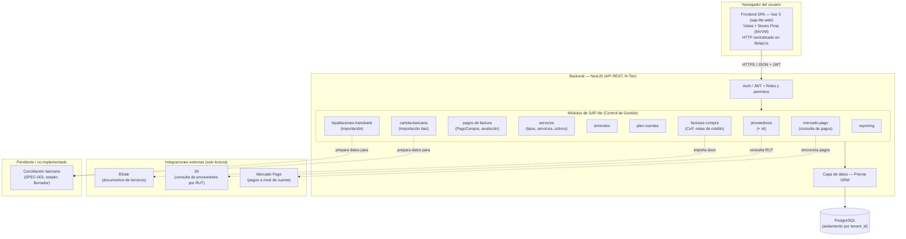
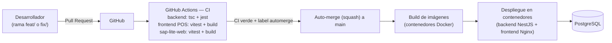

# Arquitectura — SAP-lite (Control de Gestión)

> **Evidencia académica — Proyecto CAPSTONE.** Este documento es un resumen
> técnico del módulo **SAP-lite — Control de Gestión** de PittySoft, elaborado
> a partir del código real del proyecto. No contiene credenciales, datos reales
> ni identificadores privados de infraestructura. Los ejemplos, cuando existen,
> son ficticios.

## 1. Visión general

SAP-lite — Control de Gestión es el módulo administrativo-financiero de
PittySoft. Permite administrar proveedores, facturas de compra y cuentas por
pagar, pagos de facturas, servicios y arriendos recurrentes, el Plan de Cuentas,
y la importación de documentos financieros (cartolas bancarias Itaú y
liquidaciones Transbank), además de integraciones de solo lectura con BSale,
el SII y Mercado Pago.

La aplicación sigue una arquitectura **cliente-servidor de tres capas**:

- **Frontend (Vue 3):** aplicación SPA (`sap-lite-web`) con patrón **MVVM**
  (la lógica de estado vive en *stores* Pinia; el acceso HTTP se concentra en
  `lib/api.ts`, nunca en los componentes).
- **Backend (NestJS):** API REST organizada en **N-Tier** (un *feature* = un
  módulo; la lógica de negocio vive en *services*; los *controllers* solo
  exponen endpoints).
- **Persistencia:** **PostgreSQL** accedido exclusivamente a través de
  **Prisma ORM**.

Todas las operaciones están aisladas por `tenant_id` (multi-tenant): ningún
dato cruza entre inquilinos.

## 2. Diagrama de arquitectura

## 3. Diagrama de despliegue (CI/CD y contenedores)

## 4. Responsabilidades de cada capa

### 4.1 Frontend — Vue 3 (`sap-lite-web`)
- **Qué hace:** renderiza las pantallas del módulo (proveedores, facturas de
  compra, servicios, arriendos, plan de cuentas, importaciones financieras,
  Mercado Pago) y gestiona el estado de la interfaz.
- **Patrón MVVM:** los componentes (*View*) delegan la lógica y las llamadas al
  backend en *stores* Pinia (*ViewModel*). Todo el acceso HTTP pasa por un
  cliente Axios único (`lib/api.ts`) que inyecta el token JWT y maneja el
  refresco de sesión. Los componentes no hacen HTTP directo.
- **Interacción:** consume la API REST del backend vía HTTPS/JSON; los permisos
  se validan en el servidor (no hay control de acceso de confianza en el
  cliente).

### 4.2 Backend — NestJS (N-Tier)
- **Controllers:** exponen los endpoints REST y validan la entrada mediante DTOs.
- **Services:** contienen la lógica de negocio (cálculo de totales/saldos,
  control de duplicados, baja lógica, reglas multi-tenant, etc.). Cada *feature*
  es un módulo independiente.
- **Prisma (capa de datos):** único punto de acceso a la base de datos; traduce
  las operaciones de negocio a consultas SQL tipadas.
- **Seguridad transversal:** autenticación por JWT, roles y permisos, y
  aplicación del `tenant_id` en todas las consultas.

### 4.3 Persistencia — PostgreSQL + Prisma
- El esquema (`schema.prisma`) define todos los modelos y relaciones.
- Los montos se almacenan como `Decimal(14,2)` (nunca `float`), en CLP.
- El aislamiento multi-tenant se materializa mediante el campo `tenant_id`
  presente en las entidades del dominio.

### 4.4 Integraciones externas (solo lectura)
Todas las integraciones son de **solo lectura** y disponen de un modo *mock*
para desarrollo y pruebas (seleccionable por variable de entorno), de modo que
el sistema funciona sin credenciales reales:

- **BSale (SPEC-007):** descarga de documentos de terceros (facturas y notas de
  compra ya recibidas) para alimentar Cuentas por Pagar. Nunca emite ni modifica
  documentos en BSale.
- **SII (SPEC-008 / SPEC-011):** consulta de datos de proveedores por RUT.
  Implementado con un patrón de *proveedor* (provider) seleccionable por
  configuración, de modo que existe un modo de desarrollo con datos ficticios
  sin necesidad de credenciales reales.
- **Mercado Pago (SPEC-012):** sincronización de pagos a nivel de cuenta para
  consulta en Control de Gestión. Es de solo lectura: no crea, modifica ni
  cancela pagos.

## 5. Funcionalidades implementadas vs. pendientes

| Funcionalidad | Estado |
| --- | --- |
| Gestión de proveedores (CRUD, búsqueda, duplicados, baja lógica) | ✅ Implementada |
| Importación masiva de proveedores (Excel/CSV) | ✅ Implementada |
| Facturas de compra y Cuentas por Pagar (totales, saldo, notas de crédito) | ✅ Implementada |
| Registro y anulación de pagos de facturas | ✅ Implementada |
| Servicios, tipos de servicio y cobros | ✅ Implementada |
| Arriendos y gastos comunes | ✅ Implementada |
| Plan de Cuentas (catálogo global, SPEC-016) | ✅ Implementada |
| Importación de cartolas bancarias Itaú (SPEC-002) | ✅ Implementada |
| Importación de liquidaciones Transbank (SPEC-006) | ✅ Implementada |
| Integración BSale (documentos de terceros) | ✅ Implementada (solo lectura) |
| Integración SII (consulta por RUT) | ✅ Implementada (provider *mock* por defecto) |
| Integración Mercado Pago (consulta de pagos) | ✅ Implementada (solo lectura) |
| **Conciliación bancaria (SPEC-003)** | ⏳ **Pendiente — estado "Borrador"** |

> **Importante (precisión académica):** la **importación** de cartolas bancarias
> (SPEC-002) y de liquidaciones Transbank (SPEC-006) **no equivale a conciliación
> bancaria**. La conciliación propiamente tal (cruzar liquidaciones Transbank
> contra los medios de pago del POS) está especificada en **SPEC-003**, que se
> encuentra en estado **Borrador** y **no está implementada**. Las importaciones
> dejan los datos normalizados y trazables, *preparados* para una futura
> conciliación.

## 6. Notas de confidencialidad

Este diagrama es fiel a la estructura real del proyecto, pero no revela
identificadores privados de infraestructura (proyectos de nube, dominios, IPs),
secretos ni configuraciones sensibles. Las imágenes de contenedores y la
orquestación de despliegue se describen solo a nivel conceptual.
