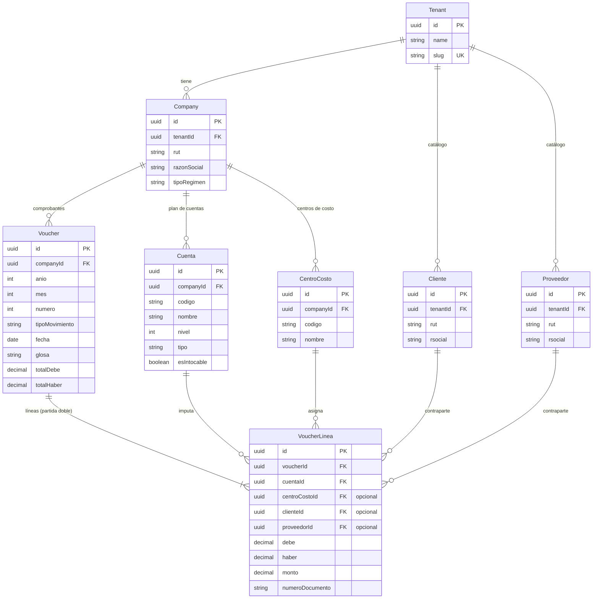

# Modelo de Datos — Entidades principales

El modelo de datos de Kuentas es **multi-tenant**: todo cuelga de un `Tenant` (la
consultora contable) y de las `Company` (empresas que esa consultora contabiliza).
El corazón transaccional es el **Voucher** (comprobante contable) y sus líneas, que
registran los movimientos bajo partida doble e imputan cada línea a una `Cuenta` del
plan de cuentas, opcionalmente a un `CentroCosto` y a una contraparte (`Cliente` o
`Proveedor`).

A continuación se muestran **solo las entidades principales** con sus campos más
relevantes. Se omiten atributos secundarios, de auditoría y entidades satélite para
mayor claridad.

## Diagrama entidad-relación

## Explicación

- **Tenant** — Representa a la consultora contable. Es la raíz del aislamiento
  multi-tenant: casi todas las consultas se acotan por su identificador. De él
  cuelgan tanto las empresas como los catálogos compartidos de clientes y proveedores.

- **Company** — Empresa contabilizada por la consultora. Una consultora puede tener
  muchas empresas, y cada una posee su propio plan de cuentas, sus centros de costo y
  sus comprobantes.

- **Cuenta** — Cuenta del plan de cuentas de una empresa. Se organiza jerárquicamente
  (niveles) y distingue cuentas "intocables" (estructurales) de las creadas por el
  usuario. Cada línea de comprobante se imputa a una cuenta.

- **CentroCosto** — Clasificador de gestión por empresa (por ejemplo, áreas o
  unidades). Es opcional en cada línea de comprobante.

- **Voucher** — Comprobante contable (el asiento). Agrupa varias líneas en un período
  (año/mes), lleva un número correlativo y mantiene los totales de Debe y Haber, que
  deben cuadrar entre sí.

- **VoucherLinea** — Línea del comprobante. Registra Debe, Haber y Monto, imputa a una
  `Cuenta` y, opcionalmente, a un `CentroCosto` y a una contraparte. La contraparte es
  **mutuamente excluyente**: una línea puede apuntar a un `Cliente` **o** a un
  `Proveedor`, nunca a ambos.

- **Cliente / Proveedor** — Maestros de contrapartes de la consultora (catálogo por
  tenant). Se identifican por RUT y se referencian desde las líneas de los comprobantes
  cuando el movimiento involucra a un tercero.
