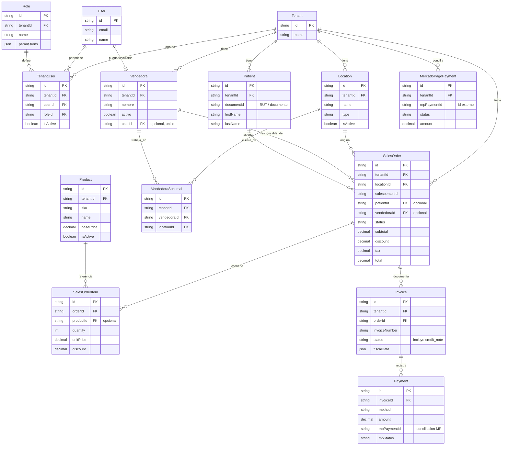

# Modelo de datos del módulo POS — PittySoft

> **Evidencia académica — Proyecto CAPSTONE, Ingeniería en Informática (Duoc UC).**
> Diagrama entidad-relación construido a partir de los modelos reales definidos en el
> esquema Prisma del proyecto (`backend/prisma/schema.prisma`). Se seleccionan las entidades
> más representativas del flujo comercial del POS para mantener el diagrama legible; el
> esquema completo contiene muchas más tablas. No se incluyen datos reales almacenados.

## 1. Alcance del diagrama

Se representan las entidades principales relacionadas con: clientes, ventas, detalles de
venta, productos, pagos, usuarios, roles, vendedoras, sucursales, devoluciones y notas de
crédito. Los nombres corresponden a los **modelos Prisma reales** y los atributos mostrados
son una selección de los más relevantes.

## 2. Diagrama entidad-relación (Mermaid)

## 3. Cómo el modelo soporta la operación comercial

**Ventas.** El carrito confirmado se persiste como `SalesOrder`, que agrupa sus líneas en
`SalesOrderItem`. Cada orden guarda sus montos (`subtotal`, `discount`, `tax`, `total`) y un
`status` (ciclo de vida: borrador, confirmada, anulada, etc.). La relación con
`SalesOrderItem` es 1 a muchos, y cada línea puede referenciar un `Product` del catálogo.

**Clientes.** El modelo moderno es `Patient`, acotado por `tenant_id` e identificado por su
documento (RUT). Una `SalesOrder` puede asociarse opcionalmente a un `Patient`. El proyecto
convive además con un modelo de cliente heredado (`Cliente`, no mostrado para mantener la
legibilidad), que se vincula con `Patient` por el documento de identidad y no por clave
foránea directa; es parte de la deuda técnica de convergencia de datos documentada en el
proyecto.

**Pagos.** Cada `SalesOrder` se documenta con uno o más `Invoice`, y cada `Invoice` registra
sus `Payment`. El modelo `Payment` soporta distintos métodos (efectivo, tarjeta, transferencia,
financiamiento) y, cuando el cobro se realiza con tarjeta vía Mercado Pago, conserva campos de
conciliación (`mpPaymentId`, `mpStatus`, entre otros). Adicionalmente, el modelo
`MercadoPagoPayment` almacena la información reportada por Mercado Pago para conciliación, de
forma independiente y acotada por tenant; la correspondencia con el pago se resuelve por el
identificador externo (`mpPaymentId`), no por clave foránea.

**Devoluciones y notas de crédito.** No existe una tabla separada de devoluciones: una nota de
crédito se modela como un `Invoice` cuyo `status` es `credit_note`, referenciando la venta
original. Así, la devolución reutiliza el mismo modelo de documento que las boletas, con sus
datos tributarios en `fiscalData`.

## 4. Usuarios, vendedoras y sucursales: identificación de la venta

El sistema distingue dos conceptos:

- **Usuario (`User`) + rol (`Role`):** la identidad de acceso. El vínculo usuario–empresa–rol
  se materializa en `TenantUser`, que porta los permisos operativos. En una `SalesOrder`, el
  campo `salespersonId` identifica **qué usuario operó el POS**.
- **Vendedora (`Vendedora`):** la persona del equipo comercial responsable de la atención,
  administrada como maestro configurable. Una `SalesOrder` referencia a la vendedora mediante
  `vendedoraId` (opcional, asociación **histórica**: desactivar una vendedora no borra ni
  altera sus ventas pasadas).

La relación **vendedora ↔ sucursal** es de muchos a muchos y se resuelve con la tabla puente
`VendedoraSucursal`, de modo que una vendedora puede trabajar en varias sucursales
(`Location`) y una sucursal tiene varias vendedoras.

Finalmente, `Vendedora` puede vincularse opcionalmente a un `User` mediante `userId` (relación
1 a 1, única). Este vínculo permite que, al iniciar sesión, el sistema identifique
automáticamente a la vendedora responsable y le asigne las ventas sin selección manual (ver
`../Especificaciones/SPEC-044_CuentaVendedora.md`).

## 5. Notas de verificación

- Todos los modelos y relaciones fueron verificados directamente en
  `backend/prisma/schema.prisma`.
- Las cardinalidades reflejan las claves foráneas y restricciones de unicidad reales (por
  ejemplo, `Vendedora.userId` es único; `VendedoraSucursal` tiene unicidad por
  `vendedoraId + locationId`).
- Se omiten entidades y atributos secundarios para favorecer la legibilidad; el esquema
  completo del proyecto contiene muchas más tablas.
