# Modelo de Datos (MER) — SAP-lite (Control de Gestión)

> **Evidencia académica — Proyecto CAPSTONE.** Diagrama entidad-relación
> construido **exclusivamente** a partir de los modelos reales definidos en el
> esquema Prisma (`backend/prisma/schema.prisma`) del proyecto PittySoft. Se
> usan los nombres reales de los modelos y solo los atributos más relevantes.
> No se incluyen datos reales almacenados en las tablas.

## 1. Diagrama entidad-relación

```mermaid
erDiagram
    Tenant ||--o{ Proveedor : "tiene"
    Tenant ||--o{ FacturaCompra : "tiene"
    Tenant ||--o{ CuentaBancaria : "tiene"
    Tenant ||--o{ TenantUser : "tiene"

    Proveedor ||--o{ FacturaCompra : "emite (opcional)"
    Proveedor ||--o{ Arriendo : "es arrendador de"
    Proveedor ||--o{ Servicio : "presta"
    Proveedor }o--o| CuentaContable : "clasifica (FK opc.)"

    CuentaContable ||--o{ FacturaCompra : "clasifica (FK opc.)"
    CuentaContable ||--o{ Arriendo : "clasifica (FK opc.)"
    CuentaContable ||--o{ Servicio : "clasifica (FK opc.)"

    FacturaCompra ||--o{ PagoCompra : "recibe"
    FacturaCompra ||--o{ MovimientoSaldoFactura : "registra en historial"
    FacturaCompra ||--o{ CobroDocumento : "se vincula a"
    FacturaCompra ||--o{ FacturaCompra : "es corregida por NC"

    TipoServicio ||--o{ Servicio : "clasifica"
    Servicio ||--o{ ServicioCobro : "genera"
    ServicioCobro ||--o{ CobroDocumento : "respalda con"

    CuentaBancaria ||--o{ ImportacionBancaria : "importa"
    CuentaBancaria ||--o{ MovimientoBancario : "contiene"
    ImportacionBancaria ||--o{ MovimientoBancario : "produce"

    ImportacionTransbank ||--o{ LiquidacionTransbank : "produce"

    Location ||--o{ Arriendo : "ubica (opc.)"
    Location ||--o{ Servicio : "ubica (opc.)"

    User ||--o{ TenantUser : "pertenece a"
    Role ||--o{ TenantUser : "asigna"
    Tenant ||--o{ Location : "tiene"
    User ||--o{ UserLocation : "accede a"
    Location ||--o{ UserLocation : "habilita a"

    Proveedor {
        string id PK
        string tenantId FK
        string rut "opcional, único por tenant"
        string razonSocial
        string nombreFantasia
        string cuentaContableId FK "opc. (Plan de Cuentas)"
        enum origen "MANUAL / MOCK / SII"
        boolean activo
    }
    FacturaCompra {
        string id PK
        string tenantId FK
        string proveedorId FK "opcional"
        enum tipoDocumento "FACTURA / NOTA_CREDITO / OTRO"
        string folio
        decimal neto
        decimal iva
        decimal total "= neto + iva + exento"
        decimal saldoPendiente
        enum estado
        string cuentaContableId FK "opcional"
        string documentoCorregidoId FK "self (NC)"
    }
    PagoCompra {
        string id PK
        string tenantId FK
        string facturaCompraId FK
        date fecha
        decimal monto "> 0, CLP"
        string referencia "único por factura"
        boolean anulado
    }
    MovimientoSaldoFactura {
        string id PK
        string facturaCompraId FK
        enum motivo
        decimal valorAnterior
        decimal valorNuevo
    }
    TipoServicio {
        string id PK
        string tenantId FK
        string nombre "único por tenant"
        boolean activo
    }
    Servicio {
        string id PK
        string tenantId FK
        string proveedorId FK
        string tipoServicioId FK
        string locationId FK "opcional"
        string cuentaContableId FK "opcional"
        boolean activo
    }
    ServicioCobro {
        string id PK
        string servicioId FK
        decimal monto "opcional"
        enum estadoPago
    }
    CobroDocumento {
        string id PK
        string cobroId FK
        string facturaCompraId FK
    }
    Arriendo {
        string id PK
        string tenantId FK
        string proveedorId FK
        string locationId FK "opcional"
        enum tipo "ARRIENDO / ..."
        decimal monto "opcional"
        string cuentaContableId FK "opcional"
        boolean activo
    }
    CuentaContable {
        string id PK
        string codigo "no único"
        string nombre
        enum tipo "AGRUPADORA / DETALLE"
        int nivel
        string codigoPadre "derivado"
    }
    CuentaBancaria {
        string id PK
        string tenantId FK
        enum banco "ITAU"
        string numeroCuenta
        string moneda "CLP"
    }
    ImportacionBancaria {
        string id PK
        string cuentaBancariaId FK
        string fileHash "SHA-256"
        int totalFilas
        int aceptadas
        int duplicadas
    }
    MovimientoBancario {
        string id PK
        string cuentaBancariaId FK
        string importacionId FK
        date fecha
        enum tipo "ABONO / CARGO"
        decimal monto
        string huella "dedup"
        enum estado "PENDIENTE"
    }
    ImportacionTransbank {
        string id PK
        string tenantId FK
        string fileHash "SHA-256"
        int totalFilas
        int aceptadas
    }
    LiquidacionTransbank {
        string id PK
        string importacionId FK
        date fechaAbono
        decimal totalVentas
        decimal comision
        decimal totalAbono
        string huella "dedup"
        enum estado "PENDIENTE"
    }
    Tenant {
        string id PK
        string slug
        enum plan
        string countryCode
    }
    User {
        string id PK
        string email "único"
        string name
    }
    TenantUser {
        string id PK
        string tenantId FK
        string userId FK
        string roleId FK
        boolean isActive
    }
    Role {
        string id PK
        string tenantId FK "opcional"
        string name
        json permissions
    }
    Location {
        string id PK
        string tenantId FK
        string code
        string name
        enum type "branch / warehouse / ecommerce"
    }
    UserLocation {
        string userId FK
        string locationId FK
    }
```

## 2. Cómo el modelo soporta la gestión del módulo

- **Proveedores:** `Proveedor` es el maestro central. Guarda identificación
  (RUT opcional, único por *tenant*), datos de contacto y de pago, y un origen
  (`MANUAL`, `MOCK`, `SII`). Desde él cuelgan las relaciones con facturas,
  servicios y arriendos.
- **Facturas de compra y Cuentas por Pagar:** `FacturaCompra` almacena los
  montos (`neto`, `iva`, `exento`, `total`) y el `saldoPendiente`, que el
  backend recalcula. Las **notas de crédito** no son una tabla aparte: son
  `FacturaCompra` con `tipoDocumento = NOTA_CREDITO` que referencian al
  documento original mediante la relación consigo misma
  (`documentoCorregidoId`).
- **Pagos y su historial:** cada pago es un registro `PagoCompra` ligado a una
  factura; la anulación es lógica (`anulado = true`) y no borra el registro. El
  modelo `MovimientoSaldoFactura` conserva un **historial append-only** de los
  cambios de saldo (por notas de crédito, pagos, etc.), con el valor anterior y
  el nuevo.
- **Servicios y cobros:** `TipoServicio` cataloga los tipos; `Servicio` liga un
  servicio a un proveedor, un tipo y (opcionalmente) una sucursal; cada
  `ServicioCobro` representa un cargo del servicio, y `CobroDocumento` vincula un
  cobro con una o varias `FacturaCompra`.
- **Arriendos:** `Arriendo` registra arriendos y gastos comunes con FK al
  proveedor (arrendador) y, opcionalmente, a una sucursal.
- **Plan de Cuentas:** `CuentaContable` es un **catálogo global** (sin
  `tenant_id`), cargado desde una planilla maestra. Proveedores, facturas,
  servicios y arriendos pueden referenciarlo mediante una FK **opcional e
  informativa** (`cuentaContableId`); esa referencia no genera asientos ni
  afecta montos.
- **Importaciones financieras:** las cartolas Itaú se modelan con
  `CuentaBancaria` → `ImportacionBancaria` → `MovimientoBancario`; las
  liquidaciones Transbank con `ImportacionTransbank` → `LiquidacionTransbank`.
  Ambos flujos usan un `fileHash` (SHA-256) a nivel de archivo y una `huella` a
  nivel de registro para controlar duplicados, y nacen en estado `PENDIENTE`.

## 3. Usuarios, permisos y sucursales (control de acceso)

- Un `User` puede pertenecer a uno o más `Tenant` a través de `TenantUser`, que
  le asigna un `Role`.
- Los permisos **no** se modelan en una tabla normalizada: se almacenan como un
  campo `json` (`permissions`) dentro de `Role`. El backend evalúa esos permisos
  en cada endpoint.
- Las sucursales/ubicaciones se modelan con `Location` (tipo `branch`,
  `warehouse` o `ecommerce`). La tabla intermedia `UserLocation` habilita a un
  usuario a operar en determinadas sucursales. En SAP-lite, los servicios y
  arriendos pueden asociarse a una `Location`.
- El aislamiento multi-tenant se garantiza porque casi todas las entidades del
  dominio llevan `tenant_id`, y las consultas siempre lo aplican.

## 4. Conceptos sin modelo propio (aclaraciones)

> Los permisos y su almacenamiento como JSON dentro de `Role` ya se explican en
> la sección 3 (Usuarios, permisos y sucursales); no se repiten aquí.

- **Medios de pago (catálogo):** el medio de pago de un `PagoCompra` es un campo
  de **texto libre**; aún no existe un catálogo formal de medios de pago.
- **Conciliación bancaria:** no existe un modelo de conciliación. Los modelos de
  movimientos bancarios y liquidaciones Transbank incluyen campos
  (monto normalizado, fecha, referencia, huella) *preparados* para una futura
  conciliación (SPEC-003, en estado Borrador), pero no hay entidad ni relación
  de "match" implementada.

> Todas las entidades y relaciones mostradas fueron verificadas directamente en
> `schema.prisma`. No se inventaron entidades, campos ni relaciones. Para
> mantener el diagrama legible se omitieron tablas no representativas del módulo
> (p. ej. las de agendamiento clínico, POS o catálogo de productos).
