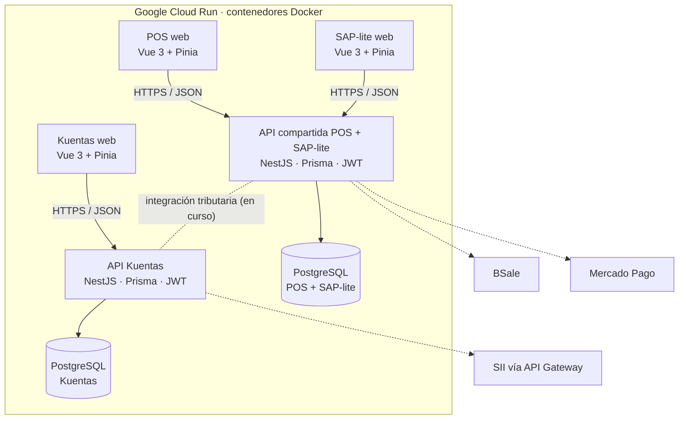

# PittySoft – Proyecto Capstone Grupo 8

## Descripción del proyecto

PittySoft es una solución informática modular desarrollada como parte del Proyecto APT de la asignatura Capstone de Ingeniería en Informática de Duoc UC.

El proyecto está dirigido a una empresa del rubro óptico y busca centralizar y optimizar sus procesos administrativos, comerciales y contables, que actualmente se encuentran distribuidos entre distintos sistemas, planillas y fuentes de información, lo que obliga a digitar, revisar y cruzar datos de forma manual.

La solución se encuentra compuesta por tres módulos principales:

- **POS – Punto de Venta:** orientado a los procesos de venta, clientes, citas, medios de pago, devoluciones y operación comercial de la óptica.
- **SAP-lite – Control de Gestión:** orientado a proveedores, facturas de compra, importaciones financieras, Plan de Cuentas, arriendos, pagos de servicios y procesos administrativos.
- **Kuentas – Contabilidad:** orientado a procesos contables, plan de cuentas, comprobantes, importación de información y procesos tributarios en desarrollo.

---

## Integrantes

| Integrante | Rol |
|---|---|
| **Axel Blanlot** | Responsable principal del módulo POS |
| **Sebastian Quezada** | Responsable principal del módulo SAP-lite |
| **Gabriel Bermar** | Responsable principal del módulo Kuentas |

Las actividades de integración, pruebas, validación, documentación y seguimiento del proyecto son desarrolladas colaborativamente por los integrantes del equipo.

---

## Objetivo general

Desarrollar una solución informática modular que permita centralizar y optimizar los procesos administrativos, comerciales y contables de una empresa del rubro óptico, mediante la implementación e integración de los módulos SAP-lite, POS y Kuentas.

---

## Módulos del proyecto

### POS – Punto de Venta

El módulo POS contempla funcionalidades relacionadas con:

- Gestión de clientes.
- Gestión de productos.
- Flujo de venta.
- Carrito de compra.
- Medios de pago.
- Gestión de vendedoras por sucursal.
- Agenda y citas.
- Devoluciones.
- Integración con BSale.
- Integración de pruebas con Mercado Pago.
- Indicadores y Dashboard.

Actualmente existen funcionalidades operativas y otras que continúan en proceso de validación e integración.

### SAP-lite – Control de Gestión

SAP-lite contempla funcionalidades relacionadas con:

- Gestión e importación de proveedores.
- Consulta de información de proveedores mediante SII.
- Asociación de proveedores a cuentas contables.
- Facturas de compra y notas de crédito.
- Sincronización de documentos con BSale.
- Importación de cartolas bancarias.
- Importación de liquidaciones Transbank.
- Consulta y sincronización de pagos de Mercado Pago.
- Arriendos y gastos comunes.
- Plan de Cuentas.
- Pagos de servicios.
- Procesos de conciliación financiera.
- Reportes de gastos.

Actualmente, el módulo cuenta con funcionalidades disponibles para Proveedores, Facturas de Compra, Importaciones Financieras, Mercado Pago, Arriendos y Plan de Cuentas. Pagos de Servicios continúa en etapa de prototipo y validación, mientras que Reportes de Gastos permanece como funcionalidad pendiente de desarrollo.

El desarrollo continúa enfocado en validar las reglas de negocio, completar las integraciones pendientes y relacionar correctamente proveedores, documentos, movimientos financieros y cuentas contables.

### Kuentas – Contabilidad

Kuentas contempla funcionalidades relacionadas con:

- Plan de Cuentas.
- Registro de comprobantes contables.
- Importación masiva de vouchers.
- Soporte multimoneda.
- Migración de información contable.
- Libros e informes contables.
- Indicadores contables.
- Procesos tributarios.
- Validación de flujos con el contador de la empresa.

Actualmente se continúa trabajando en la validación de la plataforma y en funcionalidades que dependen de información o integraciones externas.

---

## Metodología de trabajo

Para el desarrollo de PittySoft se utiliza un enfoque híbrido que combina **Spec-Driven Development (SDD)** con prácticas seleccionadas del **framework Scrum**:

- **Scrum** organiza el *qué* y el *cuándo*: Backlog, priorización, sprints y revisión periódica de avances.
- **SDD** define el *cómo*: antes de implementar, cada funcionalidad cuenta con una especificación (**SPEC**) que documenta su objetivo, alcance, comportamiento esperado y criterios de aceptación.

En cada sprint se repite el mismo ciclo: **SPEC → revisión del equipo → implementación con agentes de IA (Claude Code) → pruebas e integración continua → validación con el usuario**. Ninguna funcionalidad llega a producción sin pasar por estos pasos.

---

## Tecnologías y herramientas

| Capa | Tecnologías |
|---|---|
| **Frontend** | Vue 3, TypeScript, Vite y Pinia (patrón MVVM) |
| **Backend** | API REST con NestJS sobre Fastify, Prisma ORM y autenticación JWT (arquitectura N-Tier) |
| **Base de datos** | PostgreSQL multi-tenant (datos aislados por organización) |
| **Infraestructura** | Docker y Google Cloud Run |
| **CI/CD** | GitHub Actions |
| **Pruebas** | Jest (backend) y Vitest (frontend) |
| **Integraciones** | BSale, Mercado Pago, SII (vía API Gateway) |
| **Herramientas de apoyo** | GitHub, VS Code, Claude Code, Obsidian (SPEC) y DbGate |

---

## Arquitectura de la solución

Los tres módulos comparten el mismo stack. POS y SAP-lite comparten backend y base de datos, con aplicaciones web independientes para cada módulo. Kuentas se desarrolla como una aplicación independiente, con su propio repositorio, backend y base de datos. Cada componente se ejecuta en su propio contenedor Docker en Google Cloud Run.



---

## Ejecución local

El código fuente de PittySoft pertenece a la empresa para la cual se desarrolla el proyecto, por lo que se mantiene en repositorios privados por motivos de confidencialidad: POS y SAP-lite comparten un repositorio, y Kuentas tiene uno propio. Las evidencias del funcionamiento del sistema (capturas, videos, pruebas e integración continua) se encuentran en `Fase 2/Evidencias Proyecto`.

Para quienes tengan acceso a los repositorios, el procedimiento general para ejecutar cada módulo es el siguiente.

**Requisitos:** Node.js, Docker y PostgreSQL.

**Pasos generales (backend y frontend de cada módulo):**

1. Clonar el repositorio del módulo.
2. Copiar el archivo `.env.example` como `.env` y completar las variables de entorno (conexión a la base de datos, secreto JWT y credenciales de servicios externos).
3. Instalar las dependencias: `npm install`
4. Aplicar las migraciones de la base de datos: `npx prisma migrate deploy`
5. Levantar el backend: `npm run start:dev`
6. Levantar el frontend: `npm run dev`

El detalle de cada módulo se encuentra en el README de su repositorio.

---

## Estado actual del proyecto

El proyecto se encuentra actualmente en **Fase 2 – Desarrollo Proyecto APT**.

Durante esta fase se está trabajando principalmente en:

- Desarrollo y validación de funcionalidades.
- Pruebas de los módulos POS, SAP-lite y Kuentas.
- Ajustes derivados de la retroalimentación de los usuarios.
- Integraciones con servicios externos.
- Documentación técnica y funcional.
- Seguimiento del Plan de Trabajo.
- Preparación progresiva de la integración de PittySoft.

El proyecto aún se encuentra en desarrollo, por lo que algunas funcionalidades pueden encontrarse en estado de prototipo, validación o pendientes de integración.

---

## Estructura del repositorio

```
├── Fase 1/
│   ├── Evidencias Grupales/
│   └── Evidencias Individuales/
├── Fase 2/
│   ├── Evidencias Grupales/        Guías, informe final y planillas de evaluación
│   ├── Evidencias Individuales/    Diarios de reflexión de cada integrante
│   └── Evidencias Proyecto/        Documentación, evidencias del sistema, videos y presentación
└── README.md
```

---

## Proyecto académico

Proyecto desarrollado para la asignatura **Capstone – PTY4614**, Ingeniería en Informática, Duoc UC.

**Grupo 8**
